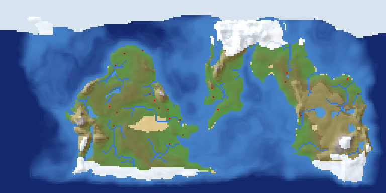
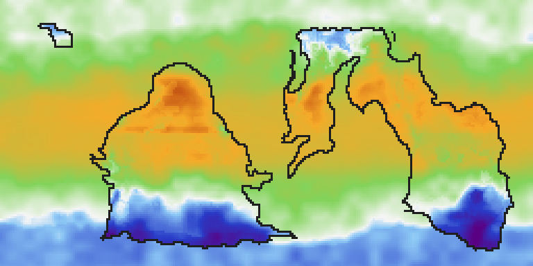
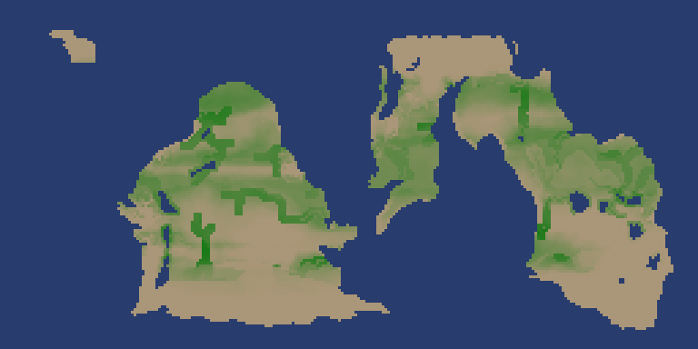
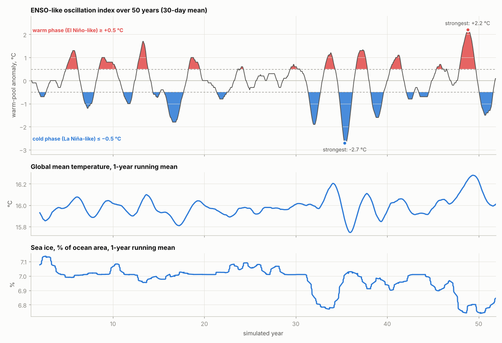
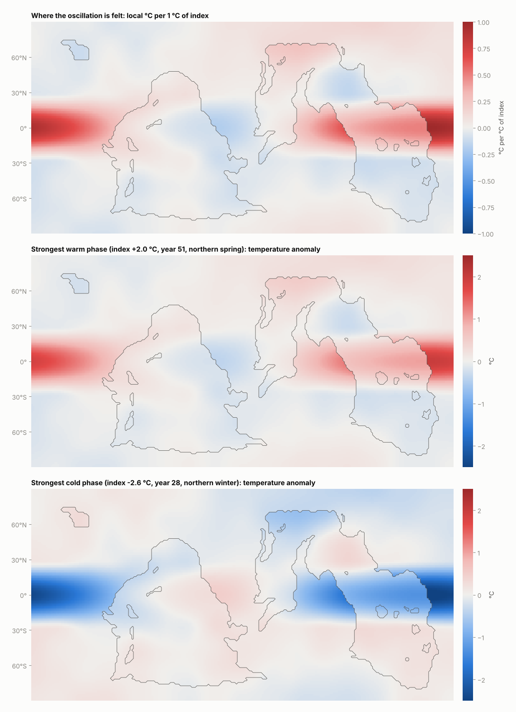
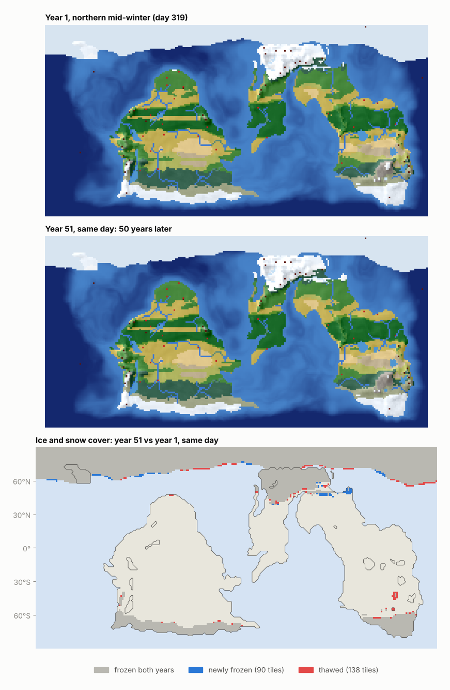
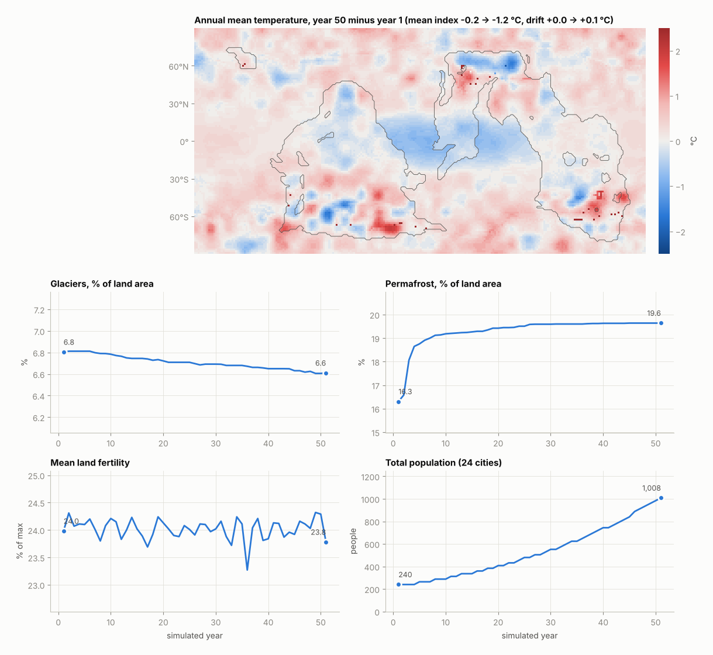

# societies

A turn-based, **fully deterministic** simulation of societies — people, morals
and beliefs, economy, diplomacy, wars and philosophies — built in Rust on an
Entity-Component-System ([`bevy_ecs`](https://crates.io/crates/bevy_ecs), used
standalone without the rest of Bevy).

Current state: a complete physical world, which is done for the foreseeable
future. It has:

- an Earth-like map (continents, altitudes, rivers, lakes, landforms and soils)
- a living climate: seasons, day and night with real day lengths, weather,
  prevailing winds and rain shadows, monsoon and Mediterranean rain, an
  El Niño-like oscillation and slow climate drift
- soil water, river discharge and floods
- a cryosphere: sea, lake and river ice, snow, frozen ground, permafrost,
  glaciers and polar caps
- 16 climate-driven biomes and land fertility
- volcanoes that erupt, cool the climate and bury land in ash
- a climate journal of notable events

Cities are placed on fertile land when the world is created, each with 10
people, and then grow slowly (logistic growth toward a carrying capacity). No
new cities are founded during play. Worlds can be saved and loaded.

**[docs/MODEL.md](docs/MODEL.md)** documents every formula: which physical
laws and published methods it is built on, and which effects and constants
are this project's own simplifications.



## Running

```sh
cargo run --release -- --seed 42 --years 5
cargo test                 # fast tests; timing and 1000-year tests are skipped
cargo test --release       # everything, including performance budgets
```

```sh
# Just look at a world: 512x256 tiles, written as a 2-pixels-per-tile PNG.
cargo run --release -- --seed 7 --width 512 --height 256 --turns 0 --quiet --png world.png --scale 2
# Temperature map on a northern mid-summer afternoon (day 136, turn 2 of 4).
cargo run --release -- --seed 3 --width 256 --height 128 --turns 545 --quiet --temp-png summer.png --scale 3
# Generate once, save, then run experiments on the same world.
cargo run --release -- --seed 3 --width 256 --height 128 --turns 0 --quiet --save-world earth.world
cargo run --release -- --load-world earth.world --years 100
```

Flags:

- **Run length:** `--years` / `--days` / `--turns` (default 2 years).
- **World:** `--seed`, `--width`, `--height`, `--land` (land share in 1/1000,
  default 330).
- **Saved worlds:** `--load-world FILE` (start from a saved world) and
  `--save-world FILE` (save the world at the end of the run; JSON if FILE ends
  in `.json`).
- **Images:** `--png FILE` (relief and biome map with current ice, snow,
  cities and volcanoes), `--temp-png FILE` (temperature map),
  `--fertility-png FILE`, `--scale` (pixels per tile). Maps show the state at
  the end of the run.
- **Output:** `--quiet`.

The run prints a terrain, volcano, biome, fertility and frozen-world summary,
a climate report at the start of every season, the event log, the climate
journal, an ASCII map, every city with its temperature and biome, and a state
digest. The same flags always produce the same digest.

Shares are by true surface area: on this equirectangular map, polar rows hold
far less area than their tile count suggests.

## World generation (`src/map/`)

Every tile has an altitude (meters relative to sea level; the bed for oceans
and lakes), a water feature (dry, river, lake, ocean), a landform (water,
plains, hills, mountains), a soil (loam, sandy, rocky, alluvial), rainfall,
accumulated river flow and the tile it drains into.

1. **Terrain** (`terrain.rs`): a domain-warped fractal field places the
   continents. Sea level is picked so that exactly `land_per_mille` of the map
   is land. Land rises inland, with ridged mountain ranges in orogenic belts.
   The sea floor has a shallow continental shelf before dropping into the deep
   ocean.
2. **Hydrology** (`hydrology.rs`): rainfall follows Earth's latitude bands and
   the prevailing winds. Moisture comes in from the sea and dries over land,
   windward slopes get orographic rain, and mountains cast rain shadows. A
   priority flood finds lakes, every tile drains by steepest descent, and
   accumulated rain forms rivers.
3. **Landform and soil** (`landform.rs`).

Then the climate is spun up for 4 years, so ice caps, snow and soil water are
in place at turn 0, and volcanoes are placed.

## Time and climate (`src/climate/`)

One turn is a quarter of a day: **morning, day, evening, night**. A year has
364 days in four seasons. Turn 0 is the first morning of northern spring.

Every tile has a temperature recomputed every turn:

```
T = annual mean + seasonal swing + day/night cycle (shrinking in polar night and midnight sun)
  + El Niño-like oscillation + slow drift + weather − volcanic aerosols − ice/snow albedo
```

and a precipitation rate:

```
P = long-term amount × seasonal cycle (monsoon, Mediterranean, continental)
  × oscillation effect × weather
```

Rain fills a soil-water bucket (`soil.rs`) that evaporates with warmth and
daylight. Runoff flows down the rivers daily, and a river floods when it tops
twice its bankfull level. Ice and snow (`cryosphere.rs`) grow and melt by
Stefan's law and degree-days, and glaciers creep and calve. Each year's
statistics (`stats.rs`) feed 10-year climate normals: per-season temperature
and rain, growing degree-days, the frost-free season, drought and floods.



## Biomes (`src/biome.rs`)

Sixteen biomes, reclassified every year from the climate normals with the
Köppen-Geiger rules (Peel et al. 2007):

- ocean, lake, ice sheet
- tundra, alpine
- boreal forest, temperate forest, temperate rainforest
- grassland, Mediterranean shrubland
- hot desert, cold desert
- savanna, tropical seasonal forest, tropical rainforest
- wetland

Because they follow the normals, biomes shift slowly as the climate drifts or
after a large eruption.

## Fertility (`src/fertility.rs`)

```
fertility = soil × water × warmth × vegetation
```

- **Soil:** from landform and soil type. Floodplain alluvium is richest, and
  land near volcanoes has rich volcanic soil.
- **Water:** from long-term rain or irrigation, cut by droughts.
- **Warmth:** from last year's growing degree-days, capped by the frost-free
  season.
- **Vegetation:** the biome's typical soils.
- **Ice and ash:** permafrost cuts fertility, ice makes land barren, and fresh
  volcanic ash ruins crops for a year or two.



## Volcanoes (`src/volcano.rs`)

Volcanoes are entities placed for a reason:

- **Subduction arcs** sit on high coastal mountains and erupt up to VEI 7.
- **Mantle hotspots** sit anywhere and erupt up to VEI 4.

Eruptions happen at Earth-like planet-wide rates: about two VEI 3 a year, a
VEI 4 every 7 years, down to a VEI 7 per millennium. Only volcanoes with
enough stored magma can produce large eruptions. Each eruption has three
effects:

- **Cooling:** sulfate aerosols cool the hemisphere (Pinatubo-scale VEI 6:
  about −0.5 °C) for a year or two.
- **Ash:** nearby harvests are ruined.
- **Casualties:** nearby cities lose people.

Every eruption is logged with when, where, why (setting, dormancy) and its
toll.

## Climate journal (`src/journal.rs`)

A short record of what leaves a mark, graded **Minor, Moderate, Major,
Severe, Cataclysmic**. It is written once per season, never per step. It
covers:

- heat waves, cold spells, droughts, deluges and floods in large regions,
  measured against their own climate normals; widespread anomalies are merged
  into one entry
- El Niño- and La Niña-like episodes and volcanic winters as they escalate
- impactful eruptions

Over 1000 years it holds about 1.5 entries a year. Severe events come about
once a generation, and Cataclysmic ones (VEI 7 eruptions, extreme El Niño
episodes) a few times per millennium. For example:

```
year 387 Spring: Severe: volcanic winter, 1.5 °C of aerosol cooling across the southern hemisphere
year 387 Spring: Cataclysmic: VEI 7 eruption of Ormarith (subduction arc along a coastal mountain range), 0 dead at (121, 45)
year 391 Autumn: Major: El Niño-like warm phase, index +2.0 °C worldwide
```

## Saving and loading worlds (`src/save.rs`)

`Simulation::save_world` / `load_world` (or `--save-world` / `--load-world`)
store the whole world: the map, the complete climate state with its random
streams, biomes, fertility, volcanoes and the journal. Cities aren't stored;
they are founded from a stored seed when a world is loaded. Generating,
saving and loading is therefore bit-identical to a fresh `Simulation::new`, and
a world saved mid-run continues exactly.

The default format is binary (deflated bincode, about 350 KB for 128×64).
Files ending in `.json` are written as JSON. Loading detects the format.

Tests that are not about world generation start from premade worlds in
`tests/fixtures/` (`tests/common/mod.rs`). A missing or outdated fixture is
regenerated automatically; delete them after changing world generation.

## Technologies (`data/technologies.json`, `src/tech.rs`)

The simulation starts in **4500 BCE**. `data/technologies.json` lists 87
technologies from fire and stone tools up to tin bronze, chariots, writing and
law codes. They fall into ten categories (baseline, agriculture, water, crafts,
metallurgy, transport, trade, knowledge, society, warfare). Each entry has:

- prerequisites: `requires` (all of them) and `requires_any` (at least one)
- environmental `needs`: biomes, landforms, water access (river, lake or coast), resources
- an `invention` weight and a `diffusion` rate
- a `start` share: the per mille of suitable cities that know it in 4500 BCE
- typed `effects`: per-mille multipliers such as `food_yield`, `move_cost_sea` and `siege`, plus `unlock` features. They are applied by later systems.

Six technologies have **regional variants** (19 in all): cereals (wheat and
barley, millet, rice, sorghum), root crops, tree crops, small livestock,
cattle and pack animals. A variant only spreads where its environment suits
it, and knowing any variant counts as knowing the technology.

Knowledge belongs to **cities** (the `Knowledge` component). When a city is
founded it gets the start-year technologies that fit its tile and
neighbours, drawn from a random stream of its own. Editing the file never
moves cities or changes the world.

The file is compiled in and checked when it loads. The checks cover:

- unique ids
- known prerequisites, and no cycles
- known effect kinds, resources and biome names
- prerequisites of starting technologies must also start
- nothing starts before its historical date

Use `--technologies FILE` or `TechTree::load` with
`Simulation::from_world_with_technologies` to try a different tree.

## Fifty years of climate

One run of seed 3 (256×128) over 50 simulated years.

**The ENSO-like oscillation.** Warm (El Niño-like) and cold (La Niña-like)
phases arrive irregularly every 2-7 years with different strengths. The
global mean temperature and sea ice follow them.



**Where it is felt.** The footprint is strongest over the tropical warm pool,
reversed on the far side of the planet, and patchy elsewhere. The two lower
maps show the temperature anomaly at the strongest warm and cold moments.



**Fifty years apart.** The same winter day in year 1 and year 51, and where ice
and snow cover changed.



**What changed.** Annual mean temperature, year 50 minus year 1, plus the
trends. With the default drift (150-year timescale, ±0.8 °C) there is no
strong climate trend over 50 years. The temperature difference is mostly the
oscillation, weather and volcanic aerosols. The ice sheets start out settled
(see the spin-up in docs/MODEL.md), so the glacier changes are small.



To regenerate the figures (needs Python with numpy, matplotlib and pillow):

```sh
cargo run --release --example figures -- /tmp/fig
python3 tools/plot_figures.py /tmp/fig docs/figures
```

## Determinism rules

Every run is a pure function of its `SimConfig` (or saved world), so
experiments with different initial conditions are reproducible. To keep it
that way, every system must:

- Draw randomness only from `SimRng` streams (a self-implemented xoshiro256**,
  pinned by tests so dependency upgrades can't change it).
- Run on the single-threaded executor, in the explicit `.chain()` order defined
  in `Simulation::from_world` (`bevy_ecs`'s `multi_threaded` feature is
  disabled).
- Never let ECS query iteration order affect outcomes — sort by a stable
  simulation id (e.g. `CityId`, `VolcanoId`) before drawing random numbers or
  breaking ties.
- Use integer / fixed-point math for simulation state, not floats.
- Avoid wall-clock time and `HashMap`/`HashSet` iteration with random hashers.

## Tests

| File | Checks |
| --- | --- |
| `tests/determinism.rs` | identical digests every turn for the same seed, cities, event log |
| `tests/terrain.rs` | land share, landforms and soils, drainage, rivers |
| `tests/climate.rs` | temperature patterns, polar caps, sea ice, permafrost, fertility rules |
| `tests/climate_dynamics.rs` | winds and rain shadows, monsoons, oscillation rain, weather, floods, soil wetness, frost-free seasons, day length |
| `tests/biomes.rs` | biomes match water and ice, variety, latitude order, yearly reclassification |
| `tests/volcanoes.rs` | placement by cause, eruption rates, event log, magma conservation, cooling and ash |
| `tests/journal.rs` | sparse, season-aligned, merged, severe eruptions and volcanic winters, escalating episodes |
| `tests/save_load.rs` | loaded worlds are identical, mid-run saves continue exactly, JSON, bad files |
| `tests/long_run.rs` | 100 years (always) and 1000 years (`--release`) of stable climate |
| `tests/performance.rs` | time budgets (`--release`) |

## Layout

| File | Contents |
| --- | --- |
| `src/lib.rs` | `Simulation`: world setup, turn schedule, snapshots, digests, ASCII render |
| `src/config.rs` | `SimConfig`: all initial conditions and tuning knobs |
| `src/rng.rs` | `SimRng`: the deterministic RNG |
| `src/time.rs` | `Turn` counter, `Date`, seasons and times of day |
| `src/map/mod.rs` | `Map` resource, `Tile`, `Landform`, `Soil`, `Water`, `TerrainConfig`, `Position` |
| `src/map/noise.rs` | Fixed-point value noise, fractal and ridged variants |
| `src/map/terrain.rs` | Continents and altitudes |
| `src/map/hydrology.rs` | Winds and rainfall, oceans, lakes, rivers |
| `src/map/landform.rs` | Landform and soil classification |
| `src/climate/mod.rs` | `Climate` resource: tile profiles, temperature, precipitation, `update_climate` system |
| `src/climate/oscillation.rs` | ENSO-like oscillator and global drift |
| `src/climate/cryosphere.rs` | Sea/lake/river ice, snow, frozen ground, permafrost, glaciers |
| `src/climate/soil.rs` | Soil water, river discharge, floods |
| `src/climate/weather.rs` | Day-to-day weather |
| `src/climate/daylight.rs` | Day length |
| `src/climate/stats.rs` | Yearly statistics, season summaries, climate normals |
| `src/climate/trig.rs` | Integer sine/cosine |
| `src/biome.rs` | `Biomes` resource and Köppen-based classification |
| `src/fertility.rs` | `Fertility` resource |
| `src/volcano.rs` | Volcano entities, `Volcanism` resource, eruptions |
| `src/journal.rs` | `Journal` resource: notable events by severity |
| `src/save.rs` | `WorldSave`: binary and JSON world files |
| `src/tech.rs`, `data/technologies.json` | Technology tree: loading, validation, regional variants, each city's `Knowledge` |
| `src/city.rs` | City components, `found_initial_cities`, the `grow_cities` system |
| `src/events.rs` | `EventLog` of happenings (city foundings, eruptions) |
| `src/render.rs` | ASCII and PNG rendering |
| `src/main.rs` | Command-line runner |
| `examples/figures.rs`, `tools/plot_figures.py` | Data dump and plotting for `docs/figures/` |
| `examples/make_world.rs` | Generate and save a world |
| `tests/common/`, `tests/fixtures/` | Premade test worlds |
| `docs/MODEL.md` | The model: laws, sources, and our own simplifications |

A turn runs: `advance_turn` → `volcanic_activity` (daily) → `update_climate`
→ `update_journal` (each season) → `update_biomes` and `update_fertility`
(each year) → `grow_cities`.
